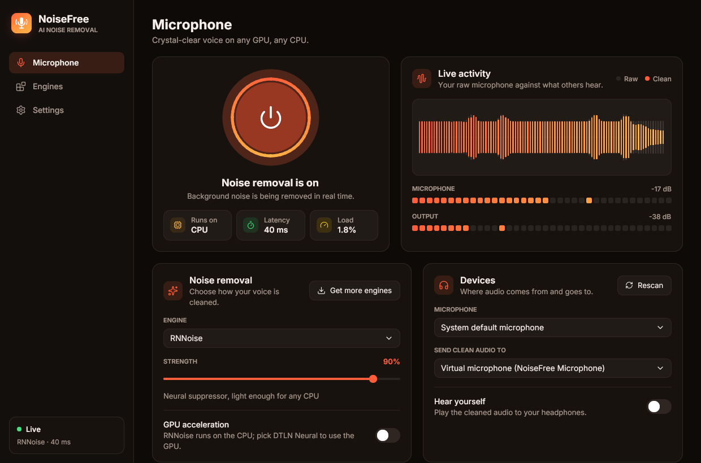
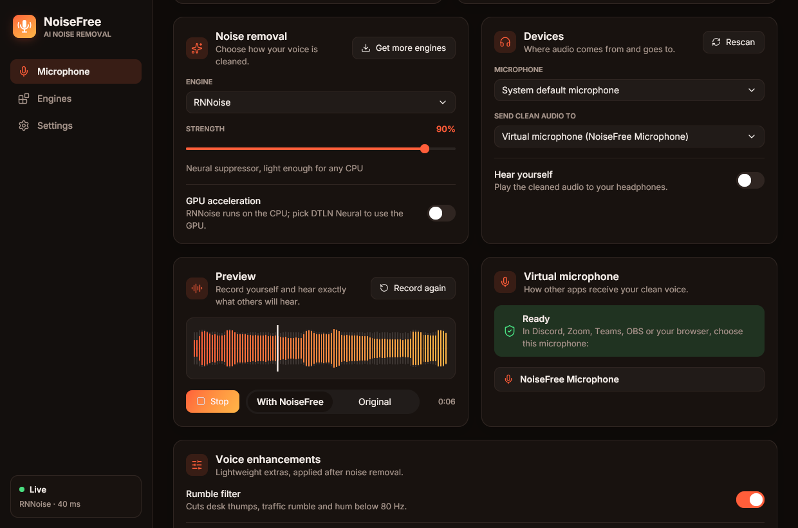
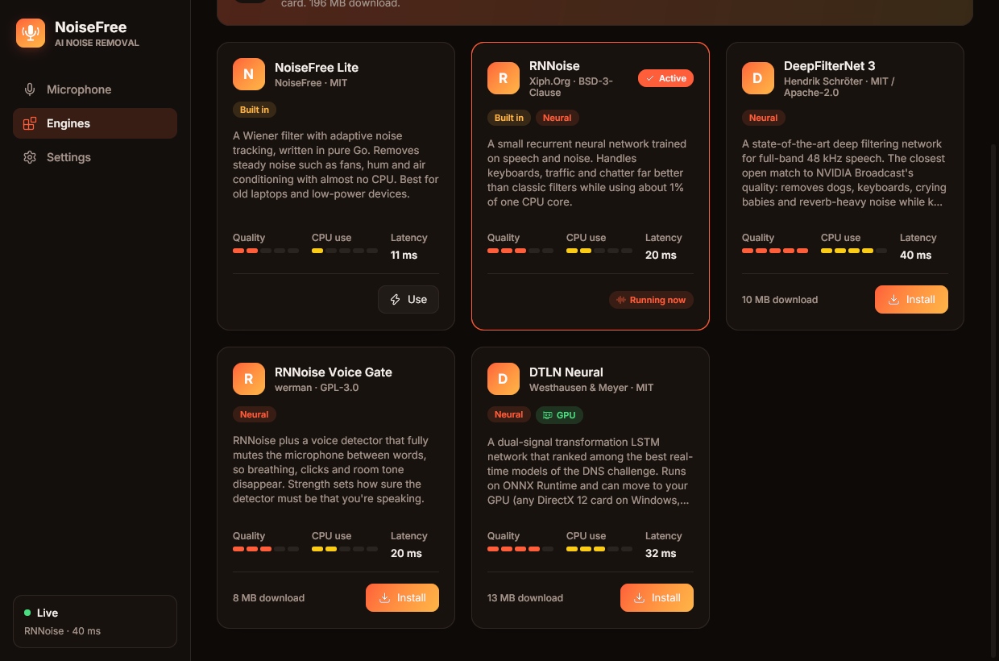

# NoiseFree

Real-time AI noise removal for your microphone, like NVIDIA Broadcast, but for
**any GPU and any CPU**. NoiseFree cleans your voice and hands it to Discord, Zoom,
Teams, OBS and the browser through a virtual microphone. Built with
[Giode](https://github.com/xmhrnx/giode) for Windows, macOS and Linux.





- **Swappable engines.** Two are built in and work offline. Install more from
  the Engines page, add any LADSPA voice plugin, or describe a new engine in a
  JSON manifest.
- **GPU optional.** Neural engines can run on DirectML (any DirectX 12 GPU:
  NVIDIA, AMD, Intel, Qualcomm), Core ML (Apple silicon) or CUDA (NVIDIA on
  Linux). If no GPU backend is available, they fall back to the CPU and tell
  you why.
- **Preview.** Record up to 10 seconds, play it back, and switch between the
  cleaned and the original take while it plays to hear the difference.
- **Your speakers stay yours.** Virtual cable drivers (VB-Audio's in
  particular) make themselves the system's default output when installed,
  which silences the computer. NoiseFree notices within seconds and switches the default
  speaker and microphone back to the real devices you used before (Windows and
  Linux; Settings → *Keep my speakers and microphone as the defaults*).
- **Light on resources.** The suppressor runs on the audio thread with no
  allocations and no extra threads. Measured in this repo's tests: RNNoise
  uses about 1–2% of one core, NoiseFree Lite about 0.4%. The UI redraws only while
  its live meters are on screen.

## Engines

| Engine | Tech | Quality | CPU | GPU | Platforms |
| --- | --- | --- | --- | --- | --- |
| NoiseFree Lite (built in) | Pure-Go Wiener filter | ●●○○○ | ●○○○○ | – | all |
| RNNoise (built in) | Xiph RNN, compiled in | ●●●○○ | ●●○○○ | – | all |
| RNNoise Voice Gate | LADSPA (werman) | ●●●○○ | ●●○○○ | – | Windows, macOS, Linux |
| DeepFilterNet 3 | LADSPA | ●●●●●| ●●●●○ | – | Windows x64, Linux x64/arm64 |
| DTLN Neural | ONNX Runtime | ●●●●○ | ●●●○○ | ✓ | Windows x64, macOS arm64, Linux x64/arm64 |

A GPU acceleration pack (ONNX Runtime with DirectML on Windows or CUDA on
Linux) installs from the Engines page. macOS doesn't need it, because Core ML
ships in the standard runtime.

### Adding your own engine

**LADSPA plugin:** Engines → Add engine → *Choose plugin file*. NoiseFree runs the
plugin's first mono effect at 48 kHz.

**Manifest:** a JSON file, picked from disk or from a URL:

```json
{
  "id": "my-denoiser",
  "name": "My Denoiser",
  "vendor": "Me",
  "version": "1.0",
  "kind": "ladspa",
  "summary": "One line for the card",
  "description": "A longer description.",
  "license": "MIT",
  "quality": 4, "cpuCost": 2, "latencyMs": 10,
  "plugin": {
    "file": "denoiser",
    "label": "my_denoiser_mono",
    "strengthControl": "Reduction",
    "strengthMin": 0, "strengthMax": 100
  },
  "downloads": {
    "linux/amd64":   [{"url": "https://…/linux.zip", "archive": "zip", "pick": [{"match": "lib/denoiser.so", "as": "denoiser"}], "sha256": "…"}],
    "windows/amd64": [{"url": "https://…/denoiser.dll", "pick": [{"as": "denoiser"}]}]
  }
}
```

- `kind`: `ladspa`, `dtln` (a folder with `model_1.onnx`/`model_2.onnx`; add
  `"requires": ["onnxruntime"]`), or `runtime`.
- `downloads` keys: `goos/goarch`, `goos` or `*`. `archive` is `zip` (also
  `.nupkg`), `tgz`, or empty for a plain file. Each `pick` matches the end of a
  path inside the archive.
- Without `strengthControl`, the strength slider blends the processed signal
  with the original, aligned for the engine's latency.
- Manifests live in `<config dir>/NoiseFree/catalog/`, and installed files in
  `<config dir>/NoiseFree/engines/<id>/`.

## Virtual microphone

| OS | How |
| --- | --- |
| Linux | NoiseFree creates **NoiseFree Microphone** itself through PulseAudio/PipeWire (`pactl`) and removes it on exit. |
| Windows | Plays into [VB-Audio Virtual Cable](https://vb-audio.com/Cable/) (free). Pick **CABLE Output** as your microphone. NoiseFree finds the cable as soon as it's installed and undoes the driver making itself your default speaker. |
| macOS | Plays into [BlackHole 2ch](https://existential.audio/blackhole/) (free). Pick **BlackHole 2ch** as your microphone. |

## Build

```sh
giode run                 # run on this computer
giode build               # dist/<platform>
giode build windows       # cross-compiles from Linux with x86_64-w64-mingw32-gcc
giode build dmg           # on a Mac
giode build deb appimage  # Linux packages
```

NoiseFree uses cgo for miniaudio (audio I/O), RNNoise and the LADSPA host, so each
platform needs a C compiler. On Linux you also need Gio's usual headers (see
`giode doctor`).

## Releases

`.github/workflows/release.yml` runs only when a GitHub release is published.
It runs `go vet` and `go test`, then builds:

- Linux: `.deb` and `.rpm`
- macOS: a universal `.dmg`
- Windows (in MSYS2): a setup `.exe` and an `.msix`

The files are attached to the release. Signing is optional: add the
`MACOS_CERT_BASE64`, `WINDOWS_CERT_BASE64` and related secrets to sign builds;
without them, builds are unsigned (Windows installs only signed MSIX packages,
so use the setup `.exe` until then). The workflow is generated from `[ci]` in
`giode.toml`; run `giode ci -f` after changing it rather than editing the file.

## Layout

```
main.go                  wiring only
internal/dsp             FFT, Wiener filter, biquad, gate, resampler, meters, framing
internal/rnnoise         Xiph RNNoise (BSD-3-Clause), compiled in
internal/ladspa          LADSPA plugin host (dlopen / LoadLibrary)
internal/dtln            DTLN on ONNX Runtime with CPU/DirectML/Core ML/CUDA
internal/engine          one Processor interface over every engine
internal/catalog         engine catalog, manifests, downloader and installer
internal/audio           miniaudio duplex pipeline, monitor output, stats
internal/vmic            virtual microphone per OS
internal/settings        JSON settings
internal/core            ties it together; no UI code
ui/                      Giode interface, one component per file
```

## Tests

```sh
go test ./...
NOISEFREE_TEST_NETWORK=1 go test ./internal/catalog -run Internet        # installs DTLN + ONNX Runtime
NOISEFREE_TEST_PULSE=1 go test ./internal/audio ./internal/vmic          # full chain, preview and default-device guard on a PulseAudio server
NOISEFREE_TEST_ORT=/path/libonnxruntime.so.1.24.4 NOISEFREE_TEST_DTLN=/path/models go test ./internal/dtln
```

## Licenses

NoiseFree bundles RNNoise (BSD-3-Clause), miniaudio via malgo (public domain /
MIT-0), Inter (SIL OFL 1.1, `ui/fonts/LICENSE.txt`) and Lucide icons (ISC,
`ui/icons/LICENSE.txt`). Downloaded engines keep their own licenses, which
their cards show (RNNoise Voice Gate is GPL-3.0; DeepFilterNet is MIT/Apache-2.0;
DTLN is MIT; ONNX Runtime is MIT).
